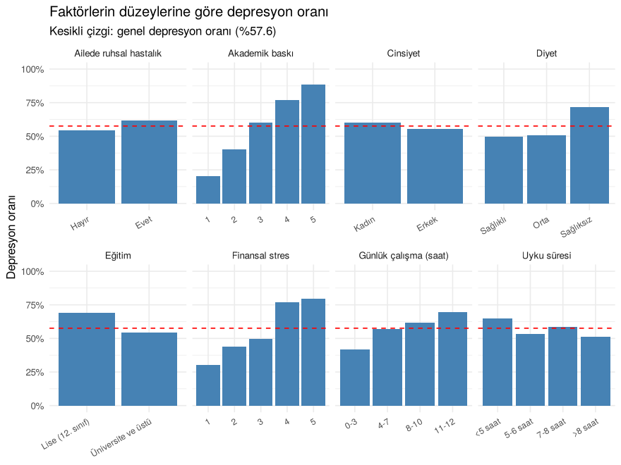
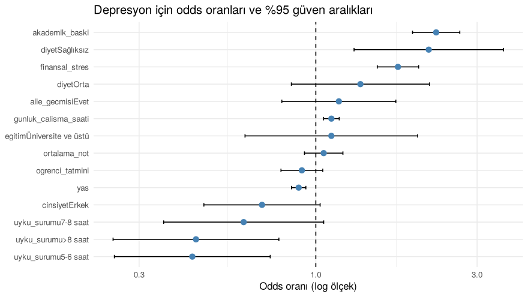

# Factors Associated with Depression in University Students

A group project for the İST347 course (fall 2025), done together with
Ayçelen Erden. Using survey data from 1000 university students, we look at how
academic pressure, financial stress and lifestyle habits relate to depression.
The full analysis, with code and output, is in [`analiz.md`](analiz.md)
(written in Turkish).

## Data

A 1000-student subsample of the
[Student Depression Dataset](https://www.kaggle.com/datasets/hopesb/student-depression-dataset)
on Kaggle, prepared for the course. It includes academic pressure, financial
stress, sleep duration, diet, daily study hours, CGPA, age, gender and a yes/no
depression indicator. 57.6% of the students in the sample report depression.

## Questions

1. Which factors are associated with depression?
2. Does perceived academic pressure differ by gender? Is sleep duration
   related to CGPA?
3. How well can depression be predicted when all factors are used together?
4. Can students be grouped into profiles based on stress and performance?

## Main findings

<p align="center">
  
</p>

- Academic pressure and financial stress have the strongest association with
  depression. The depression rate rises steadily from about 20% at the lowest
  level of academic pressure to almost 90% at the highest.
- An unhealthy diet, long study hours and sleeping less than 5 hours are also
  linked to higher depression rates.
- CGPA is not related to depression or to sleep duration, and there is no
  significant gender difference in perceived academic pressure.

A logistic regression model with all factors was fitted on 70% of the data
and evaluated on the remaining 30%:

<p align="center">
  
</p>

| | Test set |
|---|---:|
| Accuracy | 81% |
| Baseline (always predicting "depression") | 58% |
| Sensitivity | 85% |
| Specificity | 77% |
| AUC | 0.89 |

Holding the other variables constant, each one-point increase in academic
pressure multiplies the odds of depression by about 2.3, and each point of
financial stress by about 1.7. None of the interactions we tested (for example
academic pressure × sleep) were significant after a Holm correction.

K-means clustering on academic pressure, CGPA, study hours and financial
stress produced three loose profiles. A low-stress group has a depression rate
of 27%, while two high-stress groups, one with high and one with low CGPA,
both have rates around 75%. This again suggests that stress matters more than
grades.

## Methods

Chi-square tests with Cramér's V, Spearman correlations, Mann-Whitney U and
t-tests, Kruskal-Wallis and ANOVA, logistic regression with a train/test split
(accuracy, sensitivity, specificity, AUC), likelihood ratio tests for
interactions, and k-means clustering with elbow and silhouette checks.

## Limitations

The data are cross-sectional, so the results show associations, not causes.
Depression is a single yes/no item rather than a clinical diagnosis, and the
sample comes from students in India, so the findings may not generalise to
other countries.

## Files

```
analiz.Rmd   R Markdown source
analiz.md    rendered analysis (readable on GitHub)
data/        dataset
figures/     plots created by analiz.Rmd
```

To run it:

```r
install.packages(c("dplyr", "tidyr", "ggplot2", "cluster", "rmarkdown"))
rmarkdown::render("analiz.Rmd")
```

## Authors

Meryem Bakır and Ayçelen Erden
