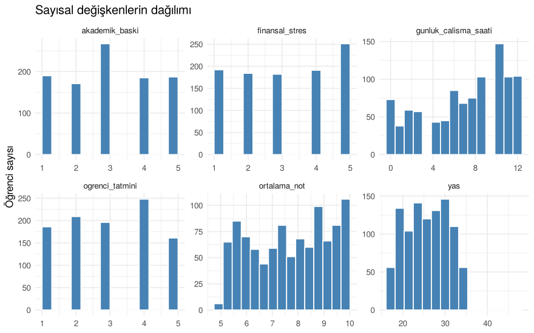
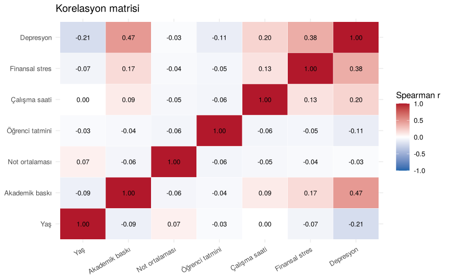
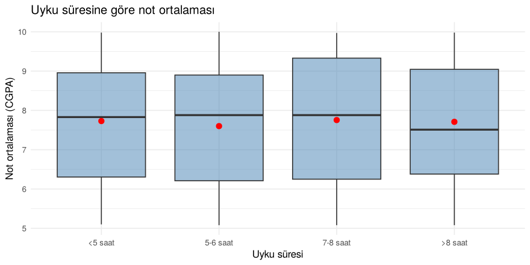
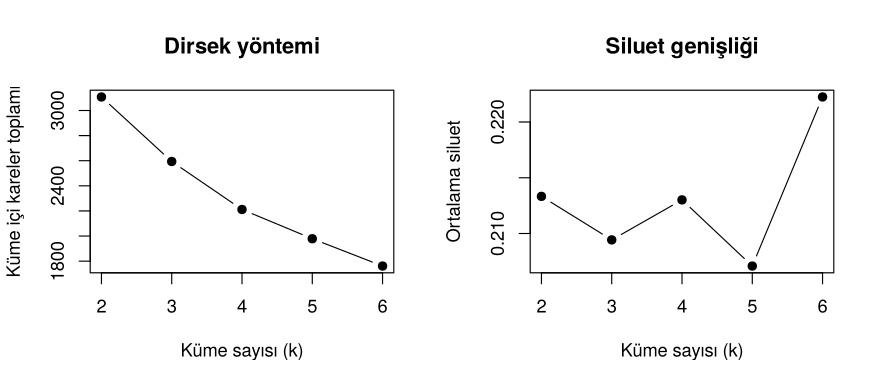
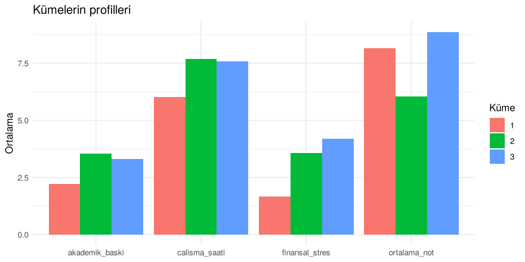

Üniversite Öğrencilerinde Depresyonla İlişkili Faktörler
================

- [1. Veri ve hazırlık](#1-veri-ve-hazırlık)
- [2. Betimsel istatistikler](#2-betimsel-istatistikler)
- [3. Depresyonla ilişkili faktörler](#3-depresyonla-ilişkili-faktörler)
- [4. Grup karşılaştırmaları](#4-grup-karşılaştırmaları)
- [5. Depresyonu tahmin eden lojistik regresyon
  modeli](#5-depresyonu-tahmin-eden-lojistik-regresyon-modeli)
- [6. Etkileşimler](#6-etkileşimler)
- [7. Öğrenci profilleri: kümeleme](#7-öğrenci-profilleri-kümeleme)
- [8. Sonuç](#8-sonuç)

İST347 dersi için 2025 güz döneminde Ayçelen Erden ile birlikte
hazırladığımız grup projesidir. Öğrencilerin akademik baskı, finansal
stres ve yaşam tarzı alışkanlıklarının depresyonla ilişkisi inceleniyor.

**Araştırma soruları**

1.  Hangi faktörler depresyonla ilişkili?
2.  Cinsiyete göre akademik baskı algısı farklı mı? Uyku süresi not
    ortalamasıyla ilişkili mi?
3.  Bu faktörler birlikte ele alındığında bir öğrencinin depresyonda
    olup olmadığı ne kadar iyi tahmin edilebilir?
4.  Öğrenciler stres ve başarı profillerine göre gruplara ayrılabilir
    mi?

``` r
library(dplyr)
library(tidyr)
library(ggplot2)
library(cluster)   # silhouette
```

## 1. Veri ve hazırlık

Veri, Kaggle’daki *Student Depression Dataset*’ten ders için seçilmiş
1000 öğrencilik bir alt örneklemdir (Hindistan’daki üniversite
öğrencileri).

``` r
ham <- read.csv2("data/ogrenci_depresyon.csv", fileEncoding = "UTF-8-BOM")
dim(ham)
```

    ## [1] 1000   18

Analiz öncesi yapılan düzenlemeler:

``` r
# Hiç değişkenlik göstermeyen sütunlar
sapply(ham[, c("is_baskisi", "is_tatmini")], unique)
```

    ## is_baskisi is_tatmini 
    ##          0          0

``` r
table(ham$meslek)
```

    ## 
    ## Architect   Student 
    ##         1       999

``` r
sum(ham$ortalama_not == 0)
```

    ## [1] 1

``` r
veri <- ham |>
  mutate(
    uyku_surumu = gsub("'", "", uyku_surumu),
    uyku_surumu = factor(uyku_surumu, levels = c("Less than 5 hours", "5-6 hours",
                                                 "7-8 hours", "More than 8 hours"),
                         labels = c("<5 saat", "5-6 saat", "7-8 saat", ">8 saat")),
    derece      = gsub("'", "", derece),
    egitim      = factor(ifelse(derece == "Class 12", "Lise (12. sınıf)", "Üniversite ve üstü")),
    diyet       = factor(diyet_aliskanlik, levels = c("Healthy", "Moderate", "Unhealthy"),
                         labels = c("Sağlıklı", "Orta", "Sağlıksız")),
    cinsiyet    = factor(cinsiyet, labels = c("Kadın", "Erkek")),
    aile_gecmisi = factor(ailede_mental_hastalik_gecmisi, labels = c("Hayır", "Evet")),
    depresyon   = factor(depresyon_durumu, labels = c("Yok", "Var")),
    ortalama_not = na_if(ortalama_not, 0)
  ) |>
  select(-is_baskisi, -is_tatmini, -meslek, -id)
```

- `is_baskisi` ve `is_tatmini` bütün öğrencilerde 0, bilgi taşımıyor.
  Çıkarıldı.
- `meslek` değişkeninde 999 öğrenci ve 1 mimar var. Çıkarıldı.
- Bir öğrencinin not ortalaması 0 girilmiş. Bu, ölçek göz önüne
  alındığında geçerli bir değer olmadığı için eksik değer olarak
  kodlandı.
- `derece` değişkeninde 27 farklı bölüm var ve en kalabalık grup 12.
  sınıf (220 kişi). Bu yüzden eğitim düzeyi “Lise” ve “Üniversite ve
  üstü” olarak iki gruba ayrıldı.
- Uyku süresi kategorileri doğal sırasına göre dizildi.
- `sakinlestirici_ilac` değişkeni depresyonun sonucu olabileceği için
  (ters nedensellik) depresyonu açıklayan modellere alınmadı.

## 2. Betimsel istatistikler

``` r
sayisal <- c("yas", "akademik_baski", "ortalama_not", "ogrenci_tatmini",
             "gunluk_calisma_saati", "finansal_stres")
ozet <- t(sapply(veri[sayisal], \(x) c(
  Ortalama = mean(x, na.rm = TRUE), Std = sd(x, na.rm = TRUE),
  Min = min(x, na.rm = TRUE), Medyan = median(x, na.rm = TRUE), Max = max(x, na.rm = TRUE))))
knitr::kable(round(ozet, 2))
```

|                      | Ortalama |  Std |   Min | Medyan | Max |
|:---------------------|---------:|-----:|------:|-------:|----:|
| yas                  |    25.81 | 4.91 | 18.00 |  25.00 |  48 |
| akademik_baski       |     3.01 | 1.37 |  1.00 |   3.00 |   5 |
| ortalama_not         |     7.70 | 1.50 |  5.08 |   7.83 |  10 |
| ogrenci_tatmini      |     2.99 | 1.36 |  1.00 |   3.00 |   5 |
| gunluk_calisma_saati |     7.09 | 3.75 |  0.00 |   8.00 |  12 |
| finansal_stres       |     3.12 | 1.46 |  1.00 |   3.00 |   5 |

``` r
veri |>
  select(all_of(sayisal)) |>
  pivot_longer(everything(), names_to = "degisken", values_to = "deger") |>
  ggplot(aes(deger)) +
  geom_histogram(bins = 15, fill = "steelblue", color = "white") +
  facet_wrap(~degisken, scales = "free", ncol = 3) +
  labs(x = NULL, y = "Öğrenci sayısı", title = "Sayısal değişkenlerin dağılımı") +
  theme_minimal()
```

<!-- -->

- Öğrencilerin yaşı 18–48 arasında, ortalama 25.8.
- Akademik baskı, öğrenci tatmini ve finansal stres 1–5 arası ölçeklerde
  ölçülmüş ve her düzeyde benzer sayıda öğrenci var.
- Günlük çalışma saatleri 0–12 arasında geniş bir aralığa yayılıyor.

``` r
kategorik <- c("cinsiyet", "egitim", "uyku_surumu", "diyet", "aile_gecmisi", "depresyon")
lapply(veri[kategorik], \(x) round(100 * prop.table(table(x)), 1))
```

    ## $cinsiyet
    ## x
    ## Kadın Erkek 
    ##  45.3  54.7 
    ## 
    ## $egitim
    ## x
    ##   Lise (12. sınıf) Üniversite ve üstü 
    ##                 22                 78 
    ## 
    ## $uyku_surumu
    ## x
    ##  <5 saat 5-6 saat 7-8 saat  >8 saat 
    ##     29.5     24.9     24.5     21.1 
    ## 
    ## $diyet
    ## x
    ##  Sağlıklı      Orta Sağlıksız 
    ##      28.5      37.2      34.3 
    ## 
    ## $aile_gecmisi
    ## x
    ## Hayır  Evet 
    ##  54.1  45.9 
    ## 
    ## $depresyon
    ## x
    ##  Yok  Var 
    ## 42.4 57.6

Öğrencilerin **%57.6**’sında depresyon var. Bu oran aşağıda kurulan
tahmin modelinin karşılaştırılacağı temel düzeydir: hiçbir bilgi
kullanmadan herkese “depresyon var” denirse doğruluk %57.6 olur.

## 3. Depresyonla ilişkili faktörler

Önce her faktörün depresyonla ilişkisine tek tek bakıldı:

``` r
oran_veri <- veri |>
  mutate(across(c(akademik_baski, finansal_stres), factor),
         calisma = cut(gunluk_calisma_saati, c(-1, 3, 7, 10, 12),
                       labels = c("0-3", "4-7", "8-10", "11-12"))) |>
  select(depresyon, `Akademik baskı` = akademik_baski, `Finansal stres` = finansal_stres,
         `Uyku süresi` = uyku_surumu, Diyet = diyet, `Günlük çalışma (saat)` = calisma,
         `Ailede ruhsal hastalık` = aile_gecmisi, Cinsiyet = cinsiyet, `Eğitim` = egitim) |>
  pivot_longer(-depresyon, names_to = "faktor", values_to = "duzey") |>
  group_by(faktor, duzey) |>
  summarise(oran = mean(depresyon == "Var"), n = n(), .groups = "drop") |>
  mutate(duzey = factor(duzey, levels = unique(duzey)))

ggplot(oran_veri, aes(duzey, oran)) +
  geom_col(fill = "steelblue") +
  geom_hline(yintercept = mean(veri$depresyon == "Var"), linetype = 2, color = "red") +
  facet_wrap(~faktor, scales = "free_x", ncol = 4) +
  scale_y_continuous(labels = scales::percent, limits = c(0, 1)) +
  labs(x = NULL, y = "Depresyon oranı",
       title = "Faktörlerin düzeylerine göre depresyon oranı",
       subtitle = "Kesikli çizgi: genel depresyon oranı (%57.6)") +
  theme_minimal() +
  theme(axis.text.x = element_text(angle = 30, hjust = 1, size = 8))
```

<!-- -->

Her faktör için ki-kare bağımsızlık testi yapıldı. Sekiz test birlikte
yapıldığı için p-değerleri Holm yöntemiyle düzeltildi. Etki büyüklüğü
Cramér’s V ile verildi.

``` r
cramer_v <- function(tablo) {
  x2 <- suppressWarnings(chisq.test(tablo, correct = FALSE))$statistic
  sqrt(x2 / (sum(tablo) * (min(dim(tablo)) - 1)))
}
faktorler <- c("akademik_baski", "finansal_stres", "uyku_surumu", "diyet",
               "gunluk_calisma_saati", "aile_gecmisi", "cinsiyet", "egitim")
testler <- t(sapply(faktorler, \(f) {
  tablo <- table(veri[[f]], veri$depresyon)
  test <- suppressWarnings(chisq.test(tablo))
  c(ki_kare = unname(test$statistic), sd = unname(test$parameter),
    p = test$p.value, cramer_v = unname(cramer_v(tablo)))
}))
testler <- as.data.frame(testler)
testler$p_holm <- p.adjust(testler$p, "holm")
knitr::kable(testler[order(-testler$cramer_v), ], digits = 4)
```

|                      |  ki_kare |  sd |      p | cramer_v | p_holm |
|:---------------------|---------:|----:|-------:|---------:|-------:|
| akademik_baski       | 228.2192 |   4 | 0.0000 |   0.4777 | 0.0000 |
| finansal_stres       | 157.2598 |   4 | 0.0000 |   0.3966 | 0.0000 |
| gunluk_calisma_saati |  52.3573 |  12 | 0.0000 |   0.2288 | 0.0000 |
| diyet                |  42.7377 |   2 | 0.0000 |   0.2067 | 0.0000 |
| egitim               |  14.6520 |   1 | 0.0001 |   0.1235 | 0.0005 |
| uyku_surumu          |  12.1683 |   3 | 0.0068 |   0.1103 | 0.0205 |
| aile_gecmisi         |   5.4116 |   1 | 0.0200 |   0.0756 | 0.0400 |
| cinsiyet             |   2.2128 |   1 | 0.1369 |   0.0491 | 0.1369 |

- **Akademik baskı** (V ≈ 0.48) ve **finansal stres** (V ≈ 0.40)
  depresyonla en güçlü ilişkili iki faktör. Baskı ya da stres düzeyi
  arttıkça depresyon oranı düzenli şekilde yükseliyor.
- **Günlük çalışma saati** ve **diyet** orta düzeyde ilişkili. Sağlıksız
  beslenen öğrencilerde depresyon oranı %72, sağlıklı ve orta düzeyde
  beslenenlerde yaklaşık %50.
- **Eğitim düzeyi**, **uyku süresi** ve **ailede ruhsal hastalık
  geçmişi** daha zayıf ama anlamlı ilişki gösteriyor. 5 saatten az
  uyuyanlarda depresyon oranı en yüksek.
- **Cinsiyet** ile depresyon arasında anlamlı bir ilişki yok.

### Sayısal değişkenler arasındaki ilişkiler

Değişkenlerin çoğu 1–5 arası sıralı ölçekler olduğu için Spearman
korelasyonu kullanıldı:

``` r
kor_degisken <- c(sayisal, "depresyon_durumu")
kor <- cor(veri[kor_degisken], method = "spearman", use = "pairwise.complete.obs")
etiket <- c("Yaş", "Akademik baskı", "Not ortalaması", "Öğrenci tatmini",
            "Çalışma saati", "Finansal stres", "Depresyon")
dimnames(kor) <- list(etiket, etiket)

as.data.frame(as.table(kor)) |>
  ggplot(aes(Var1, Var2, fill = Freq)) +
  geom_tile(color = "white") +
  geom_text(aes(label = sprintf("%.2f", Freq)), size = 3) +
  scale_fill_gradient2(low = "#2166ac", mid = "white", high = "#b2182b", limits = c(-1, 1)) +
  labs(x = NULL, y = NULL, fill = "Spearman r", title = "Korelasyon matrisi") +
  theme_minimal() +
  theme(axis.text.x = element_text(angle = 30, hjust = 1))
```

<!-- -->

``` r
cor.test(veri$akademik_baski, veri$finansal_stres, method = "spearman", exact = FALSE)
```

    ## 
    ##  Spearman's rank correlation rho
    ## 
    ## data:  veri$akademik_baski and veri$finansal_stres
    ## S = 138973609, p-value = 1.26e-07
    ## alternative hypothesis: true rho is not equal to 0
    ## sample estimates:
    ##       rho 
    ## 0.1661575

Akademik baskı ile finansal stres arasında pozitif ve anlamlı, ancak
**zayıf** bir ilişki var (r = 0.17). Not ortalaması, baskı ve stresle
neredeyse ilişkisiz. Depresyonla en güçlü korelasyonu akademik baskı
(0.47) ve finansal stres (0.38) gösteriyor. Yaş arttıkça depresyon
azalıyor (−0.21).

## 4. Grup karşılaştırmaları

### Cinsiyete göre akademik baskı

``` r
aggregate(akademik_baski ~ cinsiyet, data = veri, FUN = \(x) c(ort = mean(x), medyan = median(x)))
```

    ##   cinsiyet akademik_baski.ort akademik_baski.medyan
    ## 1    Kadın           3.090508              3.000000
    ## 2    Erkek           2.939671              3.000000

``` r
wilcox.test(akademik_baski ~ cinsiyet, data = veri, exact = FALSE)
```

    ## 
    ##  Wilcoxon rank sum test with continuity correction
    ## 
    ## data:  akademik_baski by cinsiyet
    ## W = 131432, p-value = 0.09008
    ## alternative hypothesis: true location shift is not equal to 0

``` r
t.test(akademik_baski ~ cinsiyet, data = veri)
```

    ## 
    ##  Welch Two Sample t-test
    ## 
    ## data:  akademik_baski by cinsiyet
    ## t = 1.7344, df = 950.71, p-value = 0.08317
    ## alternative hypothesis: true difference in means between group Kadın and group Erkek is not equal to 0
    ## 95 percent confidence interval:
    ##  -0.01983084  0.32150443
    ## sample estimates:
    ## mean in group Kadın mean in group Erkek 
    ##            3.090508            2.939671

Akademik baskı 1–5 arası sıralı bir ölçek olduğu için Mann-Whitney U
testi temel test olarak kullanıldı; t-testi karşılaştırma için verildi.
İki test de anlamlı bir fark göstermiyor (p ≈ 0.08–0.09). Kadınların
ortalaması biraz daha yüksek (3.09 – 2.94), ancak fark istatistiksel
olarak anlamlı değil.

### Uyku süresi ve not ortalaması

``` r
ggplot(veri, aes(uyku_surumu, ortalama_not)) +
  geom_boxplot(fill = "steelblue", alpha = 0.5, outlier.alpha = 0.3) +
  stat_summary(fun = mean, geom = "point", color = "red", size = 2.5) +
  labs(x = "Uyku süresi", y = "Not ortalaması (CGPA)",
       title = "Uyku süresine göre not ortalaması") +
  theme_minimal()
```

<!-- -->

``` r
kruskal.test(ortalama_not ~ uyku_surumu, data = veri)
```

    ## 
    ##  Kruskal-Wallis rank sum test
    ## 
    ## data:  ortalama_not by uyku_surumu
    ## Kruskal-Wallis chi-squared = 2.1992, df = 3, p-value = 0.5321

``` r
summary(aov(ortalama_not ~ uyku_surumu, data = veri))
```

    ##              Df Sum Sq Mean Sq F value Pr(>F)
    ## uyku_surumu   3    3.5   1.155   0.513  0.674
    ## Residuals   995 2241.6   2.253               
    ## 1 observation deleted due to missingness

Dört uyku grubunun not ortalamaları arasında anlamlı bir fark yok
(Kruskal-Wallis p = 0.53, ANOVA p = 0.67). Genel test anlamlı olmadığı
için ikili karşılaştırma yapılmadı. Uyku süresi not ortalamasıyla değil,
depresyonla ilişkili görünüyor (Bölüm 3).

## 5. Depresyonu tahmin eden lojistik regresyon modeli

Bölüm 3’teki faktörler ve diğer değişkenler aynı modele alındı. Böylece
her faktörün etkisi, diğerleri sabit tutulduğunda değerlendirildi.

Modelin yeni öğrencilerde ne kadar iyi çalıştığını görmek için veri
rastgele %70 eğitim ve %30 test olarak ikiye ayrıldı. Model eğitim
verisiyle kuruldu, doğruluğu test verisinde ölçüldü.

``` r
model_veri <- veri |>
  filter(!is.na(ortalama_not)) |>
  mutate(akademik_baski_c = akademik_baski, finansal_stres_c = finansal_stres)

set.seed(347)
egitim_idx <- sample(nrow(model_veri), round(0.7 * nrow(model_veri)))
egitim_seti <- model_veri[egitim_idx, ]
test_seti   <- model_veri[-egitim_idx, ]

formul <- depresyon ~ akademik_baski + finansal_stres + uyku_surumu + diyet +
  gunluk_calisma_saati + yas + egitim + cinsiyet + aile_gecmisi +
  ogrenci_tatmini + ortalama_not

model <- glm(formul, family = binomial, data = egitim_seti)
summary(model)
```

    ## 
    ## Call:
    ## glm(formula = formul, family = binomial, data = egitim_seti)
    ## 
    ## Coefficients:
    ##                          Estimate Std. Error z value Pr(>|z|)    
    ## (Intercept)              -1.42162    0.90643  -1.568  0.11679    
    ## akademik_baski            0.81992    0.08217   9.979  < 2e-16 ***
    ## finansal_stres            0.55961    0.07192   7.781 7.20e-15 ***
    ## uyku_surumu5-6 saat      -0.84160    0.27088  -3.107  0.00189 ** 
    ## uyku_surumu7-8 saat      -0.49163    0.27825  -1.767  0.07725 .  
    ## uyku_surumu>8 saat       -0.81649    0.28826  -2.833  0.00462 ** 
    ## diyetOrta                 0.30367    0.24000   1.265  0.20576    
    ## diyetSağlıksız            0.76942    0.25969   2.963  0.00305 ** 
    ## gunluk_calisma_saati      0.10606    0.02723   3.895 9.84e-05 ***
    ## yas                      -0.11680    0.02500  -4.672 2.98e-06 ***
    ## egitimÜniversite ve üstü  0.10584    0.30013   0.353  0.72436    
    ## cinsiyetErkek            -0.36666    0.20206  -1.815  0.06958 .  
    ## aile_gecmisiEvet          0.15700    0.19818   0.792  0.42825    
    ## ogrenci_tatmini          -0.09510    0.07265  -1.309  0.19053    
    ## ortalama_not              0.05367    0.06685   0.803  0.42208    
    ## ---
    ## Signif. codes:  0 '***' 0.001 '**' 0.01 '*' 0.05 '.' 0.1 ' ' 1
    ## 
    ## (Dispersion parameter for binomial family taken to be 1)
    ## 
    ##     Null deviance: 953.19  on 698  degrees of freedom
    ## Residual deviance: 637.69  on 684  degrees of freedom
    ## AIC: 667.69
    ## 
    ## Number of Fisher Scoring iterations: 5

**Odds oranları ve %95 güven aralıkları:**

``` r
or_tablo <- exp(cbind(OR = coef(model), confint.default(model)))[-1, ]
colnames(or_tablo) <- c("OR", "Alt", "Üst")
or_df <- data.frame(degisken = rownames(or_tablo), or_tablo, row.names = NULL)
knitr::kable(or_df, digits = 3)
```

| degisken                 |    OR |   Alt |   Üst |
|:-------------------------|------:|------:|------:|
| akademik_baski           | 2.270 | 1.933 | 2.667 |
| finansal_stres           | 1.750 | 1.520 | 2.015 |
| uyku_surumu5-6 saat      | 0.431 | 0.253 | 0.733 |
| uyku_surumu7-8 saat      | 0.612 | 0.355 | 1.055 |
| uyku_surumu\>8 saat      | 0.442 | 0.251 | 0.778 |
| diyetOrta                | 1.355 | 0.846 | 2.169 |
| diyetSağlıksız           | 2.159 | 1.297 | 3.591 |
| gunluk_calisma_saati     | 1.112 | 1.054 | 1.173 |
| yas                      | 0.890 | 0.847 | 0.934 |
| egitimÜniversite ve üstü | 1.112 | 0.617 | 2.002 |
| cinsiyetErkek            | 0.693 | 0.466 | 1.030 |
| aile_gecmisiEvet         | 1.170 | 0.793 | 1.725 |
| ogrenci_tatmini          | 0.909 | 0.789 | 1.048 |
| ortalama_not             | 1.055 | 0.926 | 1.203 |

``` r
ggplot(or_df, aes(OR, reorder(degisken, OR))) +
  geom_vline(xintercept = 1, linetype = 2) +
  geom_errorbarh(aes(xmin = Alt, xmax = Üst), height = 0.2) +
  geom_point(size = 2.5, color = "steelblue") +
  scale_x_log10() +
  labs(x = "Odds oranı (log ölçek)", y = NULL,
       title = "Depresyon için odds oranları ve %95 güven aralıkları") +
  theme_minimal()
```

<!-- -->

Diğer değişkenler sabitken:

- Akademik baskıdaki her 1 birimlik artış depresyon odds’unu yaklaşık
  **2.3 katına** çıkarıyor.
- Finansal stresteki her 1 birimlik artış odds’u yaklaşık **1.7 katına**
  çıkarıyor.
- Sağlıksız beslenen öğrencilerin odds’u, sağlıklı beslenenlere göre
  yaklaşık **2.2 kat** daha yüksek.
- Günlük çalışma saati arttıkça depresyon odds’u artıyor, yaş arttıkça
  azalıyor.
- 5 saatten az uyuyan öğrencilerin odds’u, 5–6 saat ve 8 saatten fazla
  uyuyanlara göre anlamlı şekilde yüksek.
- Cinsiyet, eğitim düzeyi, ailede ruhsal hastalık geçmişi, öğrenci
  tatmini ve not ortalamasının, diğer değişkenler kontrol edildiğinde
  anlamlı bir etkisi yok. Eğitim düzeyi tek başına depresyonla ilişkili
  görünüyordu (Bölüm 3); bu ilişki büyük olasılıkla yaştan
  kaynaklanıyor, çünkü lise grubundaki öğrenciler daha genç.

Bunlar ilişkilerdir, neden-sonuç ilişkisi değildir. Veri tek bir zaman
noktasında toplandığı için, örneğin depresyonun akademik baskıyı daha
yoğun algılamaya yol açması da mümkündür.

**Test verisindeki performans:**

``` r
olasilik <- predict(model, newdata = test_seti, type = "response")
tahmin <- factor(ifelse(olasilik > 0.5, "Var", "Yok"), levels = c("Yok", "Var"))
karisiklik <- table(Gerçek = test_seti$depresyon, Tahmin = tahmin)
karisiklik
```

    ##       Tahmin
    ## Gerçek Yok Var
    ##    Yok  97  29
    ##    Var  27 147

``` r
auc <- function(p, y) {           # Mann-Whitney ile ROC eğrisi altındaki alan
  r <- rank(p); n1 <- sum(y); n0 <- sum(!y)
  (sum(r[y]) - n1 * (n1 + 1) / 2) / (n1 * n0)
}
performans <- c(
  Dogruluk     = sum(diag(karisiklik)) / sum(karisiklik),
  Temel_duzey  = max(prop.table(table(test_seti$depresyon))),
  Duyarlilik   = karisiklik["Var", "Var"] / sum(karisiklik["Var", ]),
  Ozgulluk     = karisiklik["Yok", "Yok"] / sum(karisiklik["Yok", ]),
  AUC          = auc(olasilik, test_seti$depresyon == "Var")
)
round(performans, 3)
```

    ##    Dogruluk Temel_duzey  Duyarlilik    Ozgulluk         AUC 
    ##       0.813       0.580       0.845       0.770       0.885

Model, daha önce görmediği test öğrencilerinde depresyonu yaklaşık %81
doğrulukla tahmin ediyor. Bu, herkese “depresyon var” demenin vereceği
%58 doğruluğun belirgin şekilde üstünde. AUC = 0.89, modelin depresyonu
olan ve olmayan öğrencileri ayırt etme gücünün iyi olduğunu gösteriyor.

## 6. Etkileşimler

Bazı faktörlerin etkisinin başka bir faktöre göre değişip değişmediği
incelendi. Örneğin “az uyku, akademik baskının depresyon üzerindeki
etkisini artırıyor mu?” Her etkileşim, ana modele tek tek eklenip
olabilirlik oranı testiyle değerlendirildi:

``` r
tam_model <- glm(formul, family = binomial, data = model_veri)
etkilesimler <- c(
  "Finansal stres × aile geçmişi" = "finansal_stres:aile_gecmisi",
  "Akademik baskı × uyku"         = "akademik_baski:uyku_surumu",
  "Çalışma saati × diyet"         = "gunluk_calisma_saati:diyet",
  "Akademik baskı × finansal stres" = "akademik_baski:finansal_stres"
)
etk <- t(sapply(etkilesimler, \(e) {
  m <- update(tam_model, as.formula(paste(". ~ . +", e)))
  lrt <- anova(tam_model, m, test = "LRT")
  c(sd = lrt$Df[2], p = lrt$`Pr(>Chi)`[2])
}))
etk <- data.frame(etk, p_holm = p.adjust(etk[, "p"], "holm"))
knitr::kable(etk, digits = 3)
```

|                                 |  sd |     p | p_holm |
|:--------------------------------|----:|------:|-------:|
| Finansal stres × aile geçmişi   |   1 | 0.848 |  1.000 |
| Akademik baskı × uyku           |   3 | 0.685 |  1.000 |
| Çalışma saati × diyet           |   2 | 0.029 |  0.116 |
| Akademik baskı × finansal stres |   1 | 0.582 |  1.000 |

Holm düzeltmesinden sonra hiçbir etkileşim anlamlı değil. Yani bu veride
faktörlerin depresyonla ilişkisi, diğer faktörlerin düzeyine göre
belirgin şekilde değişmiyor; etkileri birbirine eklenerek ilerliyor.

## 7. Öğrenci profilleri: kümeleme

Öğrenciler akademik baskı, not ortalaması, günlük çalışma saati ve
finansal stres değişkenlerine göre k-ortalamalar yöntemiyle gruplandı.
Değişkenlerin ölçekleri farklı olduğu için önce standartlaştırıldı.
Depresyon bilgisi kümelemede kullanılmadı, sonradan kümeleri
karşılaştırmak için kullanıldı.

``` r
kume_degisken <- c("akademik_baski", "ortalama_not", "gunluk_calisma_saati", "finansal_stres")
kume_veri <- model_veri[kume_degisken]
X <- scale(kume_veri)

set.seed(123)
k_aday <- 2:6
siluet <- sapply(k_aday, \(k) {
  km <- kmeans(X, centers = k, nstart = 25)
  mean(silhouette(km$cluster, dist(X))[, "sil_width"])
})
wss <- sapply(k_aday, \(k) kmeans(X, centers = k, nstart = 25)$tot.withinss)

par(mfrow = c(1, 2))
plot(k_aday, wss, type = "b", pch = 19, xlab = "Küme sayısı (k)",
     ylab = "Küme içi kareler toplamı", main = "Dirsek yöntemi")
plot(k_aday, siluet, type = "b", pch = 19, xlab = "Küme sayısı (k)",
     ylab = "Ortalama siluet", main = "Siluet genişliği")
```

<!-- -->

``` r
par(mfrow = c(1, 1))
round(setNames(siluet, k_aday), 3)
```

    ##     2     3     4     5     6 
    ## 0.213 0.209 0.213 0.207 0.222

Siluet değerleri bütün k’lar için düşük (en fazla yaklaşık 0.2). Yani
öğrenciler birbirinden net şekilde ayrılan gruplar oluşturmuyor. Yine de
profilleri yorumlamak kolay olduğu için k = 3 ile devam edildi.

``` r
set.seed(123)
km <- kmeans(X, centers = 3, nstart = 25)
model_veri$kume <- factor(km$cluster)

profil <- model_veri |>
  group_by(kume) |>
  summarise(n = n(),
            akademik_baski = mean(akademik_baski),
            ortalama_not = mean(ortalama_not),
            calisma_saati = mean(gunluk_calisma_saati),
            finansal_stres = mean(finansal_stres),
            depresyon_orani = mean(depresyon == "Var"))
knitr::kable(profil, digits = 2)
```

| kume |   n | akademik_baski | ortalama_not | calisma_saati | finansal_stres | depresyon_orani |
|:-----|----:|---------------:|-------------:|--------------:|---------------:|----------------:|
| 1    | 343 |           2.22 |         8.15 |          6.03 |           1.67 |            0.27 |
| 2    | 326 |           3.53 |         6.04 |          7.69 |           3.57 |            0.73 |
| 3    | 330 |           3.32 |         8.87 |          7.58 |           4.20 |            0.75 |

``` r
profil |>
  select(-n, -depresyon_orani) |>
  pivot_longer(-kume) |>
  ggplot(aes(name, value, fill = kume)) +
  geom_col(position = "dodge") +
  labs(x = NULL, y = "Ortalama", fill = "Küme",
       title = "Kümelerin profilleri") +
  theme_minimal()
```

<!-- -->

Kümeler kabaca şöyle tanımlanabilir:

- **Düşük stresli öğrenciler:** finansal stres ve akademik baskı en
  düşük; depresyon oranı yaklaşık %27.
- **Stresli ve notları yüksek öğrenciler:** finansal stres en yüksek,
  notları da yüksek; depresyon oranı yaklaşık %75.
- **Stresli ve notları düşük öğrenciler:** akademik baskı yüksek,
  notları en düşük; depresyon oranı yaklaşık %73.

İki stresli grubun depresyon oranları neredeyse aynı, notları ise çok
farklı. Bu, depresyonun not ortalamasından çok stres ve baskı düzeyiyle
ilişkili olduğunu bir kez daha gösteriyor.

## 8. Sonuç

- Depresyonla en güçlü ilişkili faktörler **akademik baskı** ve
  **finansal stres**. Bu ilişkiler diğer değişkenler kontrol edildiğinde
  de devam ediyor.
- **Sağlıksız beslenme**, **uzun çalışma saatleri** ve **5 saatten az
  uyku** daha yüksek depresyon oranlarıyla ilişkili.
- **Not ortalaması** depresyonla da, uyku süresiyle de ilişkili değil.
- Lojistik regresyon modeli test verisinde depresyonu yaklaşık %81
  doğrulukla tahmin ediyor (AUC = 0.89).
- Faktörler arasında anlamlı bir etkileşim bulunmadı.

**Sınırlılıklar**

- Veri kesitsel olduğu için bulgular neden-sonuç ilişkisi göstermez.
- Depresyon tek bir evet/hayır sorusuyla ölçülmüş; klinik bir tanı
  değil.
- Örneklem Hindistan’daki öğrencilerden oluşuyor ve sonuçlar başka
  ülkelere doğrudan genellenemez.
- Kümeleme analizinde gruplar arasındaki ayrım zayıf; profiller kesin
  sınırlar yerine genel eğilimler olarak yorumlanmalı.
